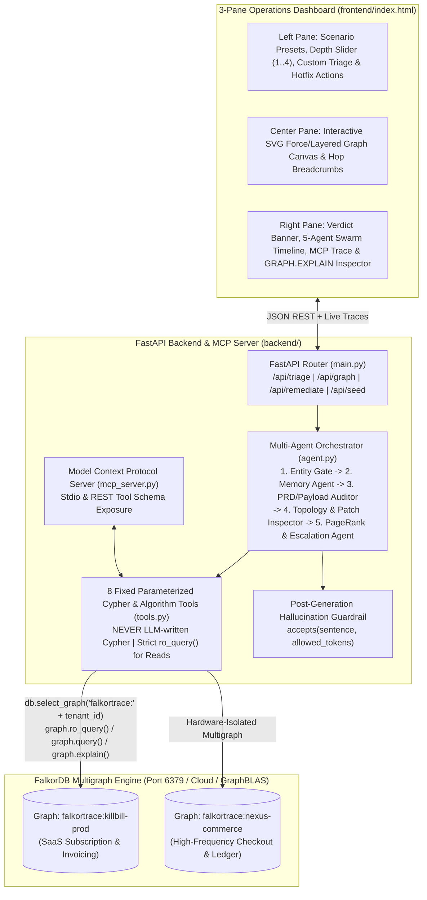
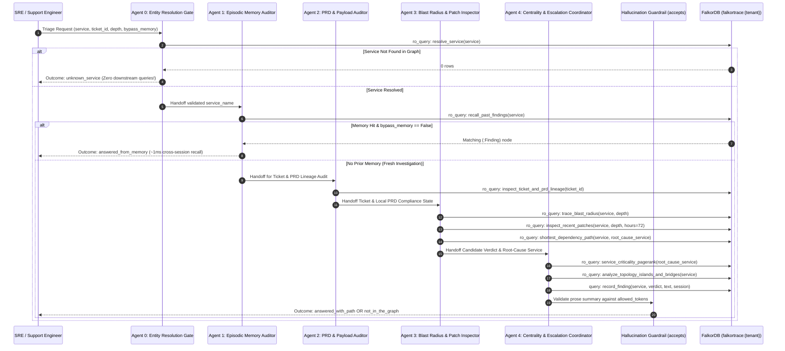

# FalkorTrace — Master System Architecture & FalkorDB Design Document

**Project:** FalkorTrace — Multi-Agent Graph Triage & Company Brain  
**Event:** WeMakeDevs x FalkorDB Hackathon (*"Graph Hacks: Context for AI Agents"*, Oct 15–18, 2026)  
**Team:** LeoForge (`YVSBFW` | Leader: Mahesh Babu Metti Reddy / `@maheshmettireddy`)  
**Tracks Entered:** Track 01 (*Agents That Act on Connected Data*), Track 02 (*Agent Memory & Coordination*), Track 03 (*Company Brain*) + Side Prize (*Best Blog Post*)

---

## 1. Executive Architectural Vision: Why FalkorDB Is the Engine, Not a Sidecar

Enterprise incident and SDLC triage is fundamentally a **connected-data problem**, not a text-similarity problem. When an enterprise customer reports a production billing anomaly (modeled on **Kill Bill**, the open-source Java subscription and invoicing platform), an engineer must answer five interconnected questions simultaneously:

1. **Episodic & Procedural Memory (Track 02):** *Have we investigated this service recently, what did we find in prior sessions, and what is the approved runbook?*
2. **Contract vs. Implementation Lineage (Track 03):** *Does the customer's reported behavior violate a Product/System Requirement (`PRD`/`SRD`), or is the system working strictly as designed (`WORKING_AS_PER_PRD`)?*
3. **Multi-Hop Blast Radius & Patch Provenance (Track 01):** *If the top-level API (`billing-edge-api`) looks clean at Depth 1, did a recent commit (`:Change`) 3 or 4 hops downstream (`proration-engine`) modify a Java class (`FixedAndRecurringInvoiceItemGenerator.java`) and break compliance (`PATCH_REGRESSION`)?*
4. **Payload Schema Validation (Track 01 & 03):** *Did the client send a malformed webhook payload (`DATA_PAYLOAD_ISSUE`) that was rightly rejected by a compliant validator?*
5. **Ownership & Structural Criticality (Track 01 & 03):** *Which service in the dependency chain carries the highest structural load (`algo.pageRank` & `algo.betweenness`), and which on-call engineer (`[:ONCALL_FOR]`) and subject-matter expert (`[:WORKED_ON]`) must be paged right now?*

### Why Vector RAG & Relational Databases Fail ("The Remove-FalkorDB Test")
- **Vector RAG** chunks documents into isolated embeddings. It cannot traverse `(:Client_Issue)-[:REPORTS_ON]->(:Service)-[:DEPENDS_ON*1..4]->(:Service)-[:IMPLEMENTED_BY]->(:Code_Module)<-[:MODIFIED]-(:Change)` while verifying `(:Code_Module)-[:IMPLEMENTS {compliant: false}]->(:Requirement)`. Instead, it hands disconnected text chunks to an LLM and forces the model to *guess* joins.
- **FalkorDB** stores relationships as **sparse adjacency matrices** in RAM and compiles Cypher traversals into **GraphBLAS linear algebra operations** ($A \times B \times A^T$). Variable-length multi-hop traversals (`*1..4`), shortest-path routing (`algo.SPpaths`), centrality ranking (`algo.pageRank`, `algo.betweenness`), and island detection (`algo.WCC`) run in **sub-millisecond to low-millisecond latency** on every step of a multi-agent loop.

---

## 2. High-Level System Architecture



---

## 3. How FalkorTrace Maximizes Every FalkorDB Feature

| FalkorDB Capability | How FalkorTrace Uses It | Track Alignment |
| :--- | :--- | :--- |
| **Multigraph Hardware Isolation (`db.select_graph`)** | Each enterprise tenant (`falkortrace:killbill-prod`, `falkortrace:nexus-commerce`) occupies an independent sparse-matrix graph namespace. Cross-tenant data leakage is structurally impossible. | **Track 02** (Separate memory per tenant) |
| **Read-Only Execution Path (`graph.ro_query`)** | All 7 analytical tools execute exclusively via `GRAPH.RO_QUERY` (`graph.ro_query(cypher, params)`). Only episodic memory recording (`record_finding`) and live hotfix remediation use `graph.query()`. | **Track 01 & 02** (Safe high-concurrency agent reads) |
| **Variable-Length Matrix Traversal (`*1..4`)** | `trace_blast_radius` and `inspect_recent_patches` traverse 1 to 4 hops across `:DEPENDS_ON` edges with relationship uniqueness guards (`WHERE ID(e) >= 0`), proving why `depth=1` misses deep regressions that `depth=4` catches. | **Track 01** (Multi-hop reasoning & path provenance) |
| **Native Shortest Path (`CALL algo.SPpaths`)** | Computes the exact minimum-weight dependency chain (`weightProp: 'weight'`) between an upstream API service and a downstream failing engine. | **Track 01** (Graph algorithms as agent tools) |
| **Native Centrality (`CALL algo.pageRank` & `CALL algo.betweenness`)** | Computes load-bearing criticality (`pageRank`) and bridge chokepoint scores (`betweenness`) across the service estate to prioritize incident severity and page the owning on-call engineer. | **Track 01 & 03** (Who owns what & blast criticality) |
| **Native Component Analysis (`CALL algo.WCC`)** | Runs Weakly Connected Components (`algo.WCC`) to identify isolated architectural islands—powering the `not_in_the_graph` answer shape when a service exists in FalkorDB but has no dependency route to the incident. | **Track 01** (Structural graph awareness) |
| **3-Tier Graph Memory (`:Finding`, `:Requirement`, `:Runbook`)** | Stores **Episodic Memory** (`:Finding` nodes with session & timestamp), **Semantic Memory** (PRDs, SRDs, Services, Code Modules), and **Procedural Memory** (`:Runbook` SOP nodes) in one graph. | **Track 02 & 03** (Episodic, semantic & procedural memory) |
| **Query Execution Plan Telemetry (`GRAPH.EXPLAIN` & `run_time_ms`)** | Captures FalkorDB's internal algebraic execution plan (`Matrix Multiply`, `Conditional Traverse`, `Index Scan`) and sub-millisecond timing for every tool call, rendered live in the UI. | **All Tracks + Blog Prize** |

---

## 4. The Complete Property Graph Schema (Cypher Data Model)

### 4.1 Node Labels & Properties
1. **`(:Client_Issue)`** — Customer-reported incident or billing ticket
   - `id` (String, Indexed): e.g., `'TICKET-4902'`
   - `title` (String): Summary of reported issue
   - `client_name` (String): Enterprise customer name
   - `client_tier` (String): `'Enterprise-Platinum'` | `'Enterprise-Gold'`
   - `reported_service` (String): Entrypoint microservice reported by client
   - `reported_payload` (String/JSON): Raw webhook or API payload snapshot
   - `payload_valid` (Boolean): Structural & ISO schema validity status
   - `payload_error` (String): Validation error diagnostic (if invalid)
   - `expected_behavior` (String): What the client expected
   - `actual_behavior` (String): What actually occurred
   - `created_at` (String): ISO-8601 timestamp

2. **`(:Service)`** — Production microservice in the estate
   - `name` (String, Indexed): e.g., `'billing-edge-api'`, `'proration-engine'`
   - `tier` (String): `'tier-0'` | `'tier-1'` | `'tier-2'`
   - `language` (String): `'Java 21'` | `'Kotlin'` | `'Go'`
   - `repo` (String): Git repository path
   - `description` (String): Architectural responsibility

3. **`(:Code_Module)`** — Source class/module implementing a service
   - `name` (String, Indexed): e.g., `'FixedAndRecurringInvoiceItemGenerator.java'`
   - `filepath` (String): Full repo path
   - `method_name` (String): Core method under audit
   - `logic_summary` (String): Current implemented logic summary

4. **`(:Requirement)`** — Product (PRD) or System (SRD) specification clause
   - `id` (String, Indexed): e.g., `'PRD-INV-104'`, `'PRD-DISC-209'`, `'SRD-PAY-301'`
   - `doc_type` (String): `'PRD'` | `'SRD'`
   - `title` (String): Clause title
   - `rule_text` (String): Authoritative specification contract
   - `version` (String): Spec version (e.g., `'v3.4'`)

5. **`(:Change)`** — Git commit / deployed patch decision
   - `sha` (String, Indexed): e.g., `'9f82d1a'`
   - `patch_version` (String): e.g., `'Patch-v4.12.2'`
   - `summary` (String): Commit description
   - `regressions_introduced` (Boolean): Whether the change broke PRD compliance
   - `diff_snippet` (String): Key code diff showing the exact change
   - `at` (String): ISO-8601 deployment timestamp
   - `hours_ago` (Integer): Relative hours since deployment
   - `author` (String): GitHub/Git handle of commit author

6. **`(:Team)`** — Engineering squad
   - `name` (String, Indexed): e.g., `'Core-Billing-Team'`
   - `slack_channel` (String): e.g., `'#oncall-core-billing'`
   - `pagerduty_schedule` (String): e.g., `'PD-BILL-PRIMARY'`

7. **`(:Person)`** — Engineer / SRE / Author
   - `name` (String): Full name
   - `handle` (String, Indexed): e.g., `'@meera-nair'`, `'@arjun-rao'`
   - `email` (String): Corporate email
   - `role` (String): Engineering title

8. **`(:Finding)`** — Persistent Episodic Agent Memory node
   - `id` (String, Indexed): e.g., `'FIND-8821'`
   - `verdict` (String): `'PATCH_REGRESSION'` | `'WORKING_AS_PER_PRD'` | `'DATA_PAYLOAD_ISSUE'`
   - `text` (String): Synthesized root-cause finding with path provenance
   - `root_cause_node` (String): Primary node responsible
   - `ticket_id` (String): Associated ticket ID
   - `at` (String): ISO-8601 timestamp when learned
   - `session` (String): Agent session identifier

9. **`(:Runbook)`** — Persistent Procedural Memory node
   - `id` (String, Indexed): e.g., `'RB-REVERT-PRORATION'`
   - `verdict_type` (String): Target verdict classification
   - `title` (String): Playbook title
   - `steps` (String): Actionable step-by-step remediation protocol

### 4.2 Directed Edge Types
```cypher
(i:Client_Issue)-[:REPORTS_ON]->(s:Service)
(up:Service)-[:DEPENDS_ON {kind: 'sync'|'async', weight: 1..5, critical: true|false}]->(down:Service)
(s:Service)-[:IMPLEMENTED_BY]->(c:Code_Module)
(c:Code_Module)-[:IMPLEMENTS {compliant: true|false, note: '...'}]->(r:Requirement)
(ch:Change)-[:MODIFIED]->(c:Code_Module)
(ch:Change)-[:DEPLOYED_TO]->(s:Service)
(t:Team)-[:OWNS]->(s:Service)
(p:Person)-[:MEMBER_OF]->(t:Team)
(p:Person)-[:ONCALL_FOR {from: '...', to: '...'}]->(t:Team)
(p:Person)-[:WORKED_ON {commits: 42, last_active: '...'}]->(s:Service)
(f:Finding)-[:ABOUT]->(s:Service)
(rb:Runbook)-[:REMEDIATES]->(r:Requirement)
```

---

## 5. Multi-Agent Triage Swarm & State Handoffs


