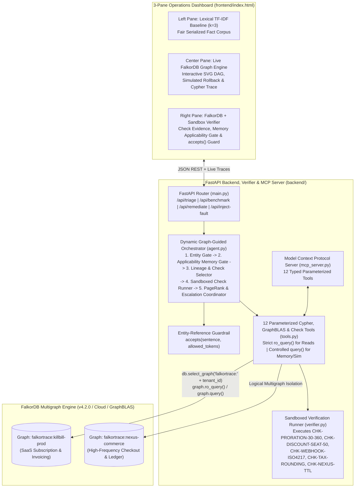

# FalkorTrace — Master System Architecture & FalkorDB Design Document

**Project:** FalkorTrace — Graph-Guided Software Investigation, Sandboxed Verification & Version-Aware Agent Memory  
**Event:** WeMakeDevs x FalkorDB Hackathon (*"Graph Hacks: Context for AI Agents"*, Oct 15–18, 2026)  
**Team:** LeoForge (`YVSBFW` | Leader: Mahesh Babu Metti Reddy / `@maheshmettireddy`)  
**Tracks Entered:** Track 01 (*Agents That Act on Connected Data*), Track 02 (*Agent Memory & Coordination*), Track 03 (*Company Brain*) + Side Prize (*Best Blog Post*)

---

## 1. Executive Architectural Vision: Why FalkorDB Is the Core Engine of a Closed-Loop Verifier

Enterprise incident and SDLC triage is fundamentally a **connected-data and executable-verification problem**, not a text-similarity problem. When an enterprise customer reports a production billing anomaly (modeled on **Kill Bill**, the open-source Java subscription and invoicing platform), an engineering agent must answer five interconnected questions simultaneously:

1. **Multi-Hop Candidate Narrowing (Track 01):** *If the top-level API (`billing-edge-api`) looks clean at Depth 1, which downstream services (`subscription-service` $\rightarrow$ `invoice-orchestrator` $\rightarrow$ `proration-engine`) and recent commits (`:Change`) sit in the 1..4 hop blast radius?*
2. **Graph-Guided Verification Check Selection & Execution (Track 01 & 03):** *Which allowlisted verification check (`(:CheckDefinition)-[:TARGETS]->(:Code_Module)`) tests the candidate module against its independent requirement specification (`(:CheckDefinition)-[:VERIFIES]->(:Requirement)`), and does executing that check against the active `ArtifactVersion` (`sha:9f82d1a` vs `sha:7c31b09`) reproduce the failure (`expected=$30.00` vs `observed=$45.00`)?*
3. **Version-Aware Investigation Memory & Applicability Gate (Track 02):** *Have we verified this exact `(tenant_id, service, input_fingerprint, artifact_sha, req_version, check_version)` before? If another supported ticket arrives on the same service with different input parameters (`TICKET-4905` Day 29 boundary), if an invalid-plan ticket has no mapped executable check, or if the code artifact was rolled back (`sha:7c31b09`), how do we prevent stale or false diagnosis reuse while preserving historical audit trails?*
4. **Payload Schema Validation vs. Contract Behavior (Track 01 & 03):** *Did the client send a malformed webhook payload (`DATA_PAYLOAD_ISSUE` verified by `CHK-WEBHOOK-ISO4217`), or is the system working strictly as designed (`WORKING_AS_PER_PRD` verified by `CHK-DISCOUNT-SEAT-50`)?*
5. **Ownership & Structural Criticality (Track 01 & 03):** *Which service in the dependency chain carries the highest structural load (`algo.pageRank` & `algo.betweenness`), and which on-call engineer (`[:ONCALL_FOR]`) and subject-matter expert (`[:WORKED_ON]`) must be paged right now?*

### Why Single-Hop Retrieval Fails & Why Static Boolean Flags Are Insufficient
- **Single-Hop Text Retrieval (`Lexical TF-IDF Baseline, k=3`)** scores isolated text chunks by lexical overlap. Even when given a **fair serialized fact corpus** containing every service, dependency edge, code module, commit, and PRD clause, single-hop retrieval surfaces chunks matching the entrypoint ticket (`billing-edge-api`) and misses the 3-hop downstream cause (`proration-engine`).
- **Why Pre-Baked Graph Booleans Are Replaced by Sandboxed Verification:** Instead of reading a static `compliant: false` property, FalkorTrace uses FalkorDB to traverse the causal graph, select the mapped `CheckDefinition`, execute the deterministic sandbox runner in [`backend/verifier.py`](../backend/verifier.py) against the active `ArtifactVersion`, and record an `(:Observation)` node containing `run_id`, `artifact_sha`, `code_hash`, `expected_value`, and `observed_value`.

---

## 2. High-Level System Architecture



---

## 3. How FalkorTrace Maximizes Every FalkorDB Feature

| FalkorDB Capability | How FalkorTrace Uses It | Track Alignment |
| :--- | :--- | :--- |
| **Logical Multigraph Isolation (`db.select_graph`)** | Each enterprise tenant (`falkortrace:killbill-prod`, `falkortrace:nexus-commerce`) occupies an independent graph key gated by `validate_tenant_scope()`. | **Track 02** (Isolated memory per tenant) |
| **Read-Only Execution Path (`graph.ro_query`)** | All analytical and check-selection tools execute exclusively via `GRAPH.RO_QUERY` (`graph.ro_query(cypher, params)`). Only memory persistence (`record_finding`) and simulated artifact mutations use `graph.query()`. | **Track 01 & 02** (Safe high-concurrency agent reads) |
| **Variable-Length Matrix Traversal (`*1..4`)** | `trace_blast_radius` and `inspect_recent_patches` traverse 1 to 4 hops across `:DEPENDS_ON` edges, proving why `depth=1` triggers a bounded-horizon truncation warning while `depth=4` uncovers deep regressions. | **Track 01** (Multi-hop reasoning & path provenance) |
| **Graph-Guided Check Selection (`:CheckDefinition`)** | `list_relevant_checks` traverses `(:Service)-[:IMPLEMENTED_BY]->(:Code_Module)-[:VERIFIED_BY]->(:CheckDefinition)` so the graph determines which sandboxed check (`run_approved_check`) to execute. | **Track 01 & 03** (Graph-guided verification) |
| **Version-Aware Memory & Non-Destructive Invalidation (`:Finding`, `:Observation`)** | Stores `(:Finding)` and `(:Observation)` nodes stamped with `(input_fingerprint, artifact_sha, req_version, check_version)`. When an artifact changes, old findings are marked `validity_state = 'STALE_VERSION_MISMATCH'` rather than deleted. | **Track 02** (Version-aware agent memory) |
| **Native Shortest Path (`CALL algo.SPpaths`)** | Computes the minimum-weight dependency chain (`weightProp: 'weight'`) between an upstream API service and a downstream failing engine. | **Track 01** (Graph algorithms as agent tools) |
| **Native Centrality (`CALL algo.pageRank` & `CALL algo.betweenness`)** | Computes load-bearing criticality (`pageRank`) and bridge chokepoint scores (`betweenness`) across the service estate to page the owning on-call engineer. | **Track 01 & 03** (Who owns what & blast criticality) |
| **Native Component Analysis (`CALL algo.WCC`)** | Runs Weakly Connected Components (`algo.WCC`) to identify isolated architectural islands—powering the `not_in_the_graph` answer shape when a service has no dependency route to the incident. | **Track 01** (Structural graph awareness) |

---

## 4. The Complete Property Graph Schema (Cypher Data Model)

### 4.1 Node Labels & Properties
1. **`(:Client_Issue)`** — Customer-reported incident or billing ticket
   - `id`, `title`, `client_name`, `client_tier`, `reported_service`, `reported_payload`, `payload_valid`, `payload_error`, `expected_behavior`, `actual_behavior`, `created_at`
2. **`(:Service)`** — Production microservice in the estate
   - `name`, `tier`, `language`, `repo`, `description`
3. **`(:Code_Module)`** — Source class/module implementing a service
   - `name`, `filepath`, `method_name`, `governed_field`, `active_artifact_sha`, `check_id`, `logic_summary`
4. **`(:ArtifactVersion)`** — Versioned code artifact snapshot
   - `id`, `module`, `service`, `version_tag`, `git_sha`, `code_hash`, `source_snippet`
5. **`(:Requirement)`** — Product (PRD) or System (SRD) specification clause
   - `id`, `doc_type`, `title`, `rule_text`, `version`, `check_id`
6. **`(:CheckDefinition)`** — Allowlisted sandboxed verification check specification
   - `id` (`CHK-PRORATION-30-360`, `CHK-DISCOUNT-SEAT-50`, `CHK-WEBHOOK-ISO4217`, `CHK-TAX-ROUNDING`, `CHK-NEXUS-TTL`), `check_version`, `target_module`, `target_service`, `requirement_id`, `requirement_version`, `description`
7. **`(:Observation)`** — Recorded execution output of a sandboxed check run
   - `id`, `run_id`, `check_id`, `check_version`, `case_id`, `target_module`, `target_service`, `requirement_id`, `requirement_version`, `artifact_sha`, `artifact_version`, `code_hash`, `expected_value`, `observed_value`, `status` (`PASS` / `FAIL`), `violation_reproduced`, `duration_ms`
8. **`(:Change)`** — Git commit / deployed patch metadata
   - `sha`, `patch_version`, `summary`, `diff_snippet`, `at`, `hours_ago`, `author`
9. **`(:Finding)`** — Persistent Version-Aware Episodic Agent Memory node
   - `id`, `verdict`, `text`, `root_cause_node`, `ticket_id`, `at`, `session`, `input_fingerprint`, `artifact_sha`, `req_version`, `check_version`, `observation_id`, `run_id`, `validity_state` (`VALID` | `STALE_VERSION_MISMATCH`), `superseded_by`
10. **`(:Runbook)`**, **`(:Team)`**, **`(:Person)`** — Procedural playbooks, owning squads, and on-call engineers.

### 4.2 Directed Edge Types
```cypher
(i:Client_Issue)-[:REPORTS_ON]->(s:Service)
(up:Service)-[:DEPENDS_ON {kind: 'sync-grpc'|'async-kafka', weight: 1..5, critical: true|false}]->(down:Service)
(s:Service)-[:IMPLEMENTED_BY]->(c:Code_Module)
(c:Code_Module)-[:IMPLEMENTS {note: '...'}]->(r:Requirement)
(c:Code_Module)-[:VERIFIED_BY]->(chk:CheckDefinition)
(chk:CheckDefinition)-[:VERIFIES]->(r:Requirement)
(c:Code_Module)-[:HAS_ARTIFACT]->(av:ArtifactVersion)
(obs:Observation)-[:OBSERVED_ON]->(c:Code_Module)
(obs:Observation)-[:EXECUTED_CHECK]->(chk:CheckDefinition)
(obs:Observation)-[:TESTED_REQUIREMENT]->(r:Requirement)
(obs:Observation)-[:USED_ARTIFACT]->(av:ArtifactVersion)
(ch:Change)-[:MODIFIED]->(c:Code_Module)
(ch:Change)-[:DEPLOYED_TO]->(s:Service)
(t:Team)-[:OWNS]->(s:Service)
(p:Person)-[:MEMBER_OF]->(t:Team)
(p:Person)-[:ONCALL_FOR {from: '...', to: '...'}]->(t:Team)
(p:Person)-[:WORKED_ON {commits: 42}]->(s:Service)
(f:Finding)-[:ABOUT]->(s:Service)
(f:Finding)-[:EVIDENCED_BY]->(obs:Observation)
(f:Finding)-[:USES_CHECK]->(chk:CheckDefinition)
(f:Finding)-[:EVIDENCES_REQUIREMENT]->(r:Requirement)
(f:Finding)-[:ABOUT_ARTIFACT]->(av:ArtifactVersion)
(rb:Runbook)-[:REMEDIATES]->(r:Requirement)
```

---

## 5. Dynamic Graph-Guided Triage & Verification Sequence

```mermaid
sequenceDiagram
    autonumber
    participant User as SRE / Support Engineer
    participant Gate as Step 1: Entity Resolution Gate
    participant Mem as Step 2: Version-Aware Memory Gate
    participant Topo as Step 3: Lineage & Candidate Narrowing
    participant Ver as Step 4: Sandboxed Check Runner
    participant Crit as Step 5: Centrality & Escalation
    participant Guard as Entity-Ref Guardrail (accepts)
    participant DB as FalkorDB (falkortrace:{tenant})

    User->>Gate: Triage Request (service, ticket_id, depth, bypass_memory)
    Gate->>DB: ro_query: resolve_service(service)
    alt Service Not Found in Graph
        DB-->>Gate: 0 rows
        Gate-->>User: Outcome: unknown_service (0 downstream queries!)
    else Service Resolved
        Gate->>Mem: inspect_ticket_and_prd_lineage + compute_input_fingerprint
        Mem->>DB: ro_query: recall_past_findings(service)
        Mem->>Mem: evaluate_memory_applicability(input_fp, active_artifact_sha, req_version)
        alt Exact Fingerprint & Active Artifact Match (REUSE_APPLICABLE_OBSERVATION)
            Mem-->>User: Outcome: answered_from_memory (no sandbox re-run; request latency is deployment-dependent)
        else Different Input (HYPOTHESIS_ONLY) or Stale SHA (INVALIDATED_STALE_VERSION) or Fresh
            alt Invalid Client Payload Detected Locally
                Mem->>Ver: Dynamic Branch: run_approved_check(mapped allowlisted check)
                Ver->>DB: query: record_finding(DATA_PAYLOAD_ISSUE, fingerprint)
            else Multi-Hop Investigation Required
                Mem->>Topo: ro_query: trace_blast_radius(depth) & inspect_recent_patches(depth)
                Topo->>DB: ro_query: list_relevant_checks(candidate_service, module)
                Topo->>Ver: run_approved_check(check_id, active_artifact_sha, payload)
                Ver-->>Topo: Observation(run_id, expected_value, observed_value, status=PASS|FAIL)
                Topo->>Crit: ro_query: shortest_dependency_path(SPpaths) & service_criticality_pagerank()
                Crit->>DB: query: record_finding(verdict, fingerprint, observation_id)
            end
            Crit->>Guard: Validate entity references via accepts(sentence, allowed_tokens)
            Guard-->>User: Outcome: answered_with_path OR not_in_the_graph
        end
    end
```
